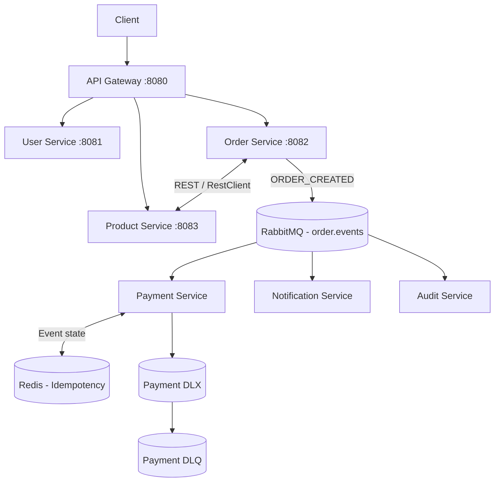

# E-Commerce Microservices v2 — System Architecture

## Overview

An event-driven e-commerce microservices application built using Java 25, Spring Boot, Spring Cloud Gateway, RabbitMQ, and Redis.

The system demonstrates synchronous REST communication, asynchronous event-driven messaging, payment idempotency, inventory concurrency protection, and failure handling.

## High-Level Architecture

## Service Responsibilities

| Service | Responsibility |
|---|---|
| API Gateway | Centralized API routing |
| User Service | User-related APIs |
| Product Service | Product information and stock reservation |
| Order Service | Order creation and business logic |
| Payment Service | Payment event processing and idempotency |
| Notification Service | Order event consumption |
| Audit Service | Order event auditing |

## Communication Patterns

### Synchronous Communication

Order Service communicates with Product Service using Spring RestClient.

### Asynchronous Communication

Order Service publishes `ORDER_CREATED` events to the RabbitMQ topic exchange `order.events`.

The event is routed to:

- `payment.queue`
- `notification.queue`
- `audit.queue`

## Redis Idempotency

Payment Service uses Redis to maintain event-processing states.

Key format:

`payment:event:{eventId}`

Atomic `SET NX` is used to claim an event before processing.

Duplicate event deliveries are skipped when the event has already been claimed.

## Payment Failure Handling

- Configured retry with exponential backoff.
- Configured `payment.dlx`.
- Configured `payment.dlq`.
- Implemented a DLQ replay service.

## Inventory Concurrency

Product Service provides synchronized stock reservation and release operations.

Insufficient stock returns HTTP 409 Conflict.

**Current limitation:** Synchronization protects a single Product Service instance. It is not distributed locking or database-level concurrency control.

## Technology Stack

Java 25 · Spring Boot 4.1.1 · Spring Cloud Gateway · RabbitMQ 4 · Redis 7 · Docker · Maven

## Future Improvements

- MySQL persistence
- Database-level inventory locking
- Transactional Outbox Pattern
- Order API idempotency
- Distributed tracing
- Production-grade recovery mechanisms